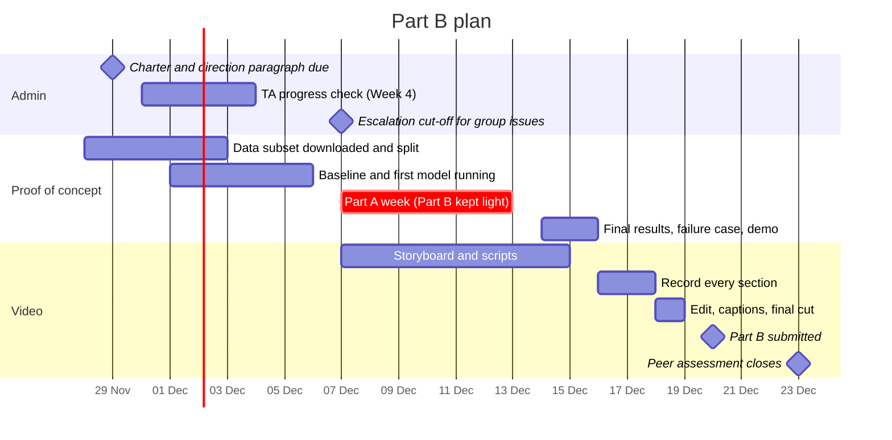

# Internal timeline (proposal, to agree on 27 Nov)

**The plan gets a baseline running before Part A's deadline on 13 Dec**, so the last week is about improving and presenting, not starting from zero.

| By | Milestone | Owner | Done when |
|---|---|---|---|
| Sun 29 Nov | Charter signed and direction paragraph uploaded | Coordinator | Both on Canvas |
| Thu 3 Dec | Dataset subset downloaded, licence checked, split by object/trial | Data lead | Split counts and the grouping column are in the notebook |
| 30 Nov to 4 Dec | Progress check with the TA | Everyone | Direction, dataset and plan presented; feedback minuted |
| Sun 6 Dec | Baseline and first model trained, first validation numbers | Modelling lead | Validation metric logged in an issue |
| 7 to 13 Dec | Part A week: storyboard and scripts drafted, no heavy Part B work | Video producer | Storyboard agreed |
| Wed 16 Dec | Final test results, one explained failure case, demo clip | Evaluation and demo lead | Results table and clip in the shared folder |
| Fri 18 Dec | Everyone's section recorded | Everyone | Clips in the shared folder |
| Sat 19 Dec | Final cut watched together, timing under 4:50, captions checked | Video producer | Group sign-off minuted |
| Sun 20 Dec | Upload video, code zip, contributions form; email the TA | Coordinator | Canvas confirmation saved |
| Wed 23 Dec | Peer assessment done by all six | Everyone | Each member confirms in the group chat |

Saturday 19 Dec is the buffer day. Nothing new gets added after it.
